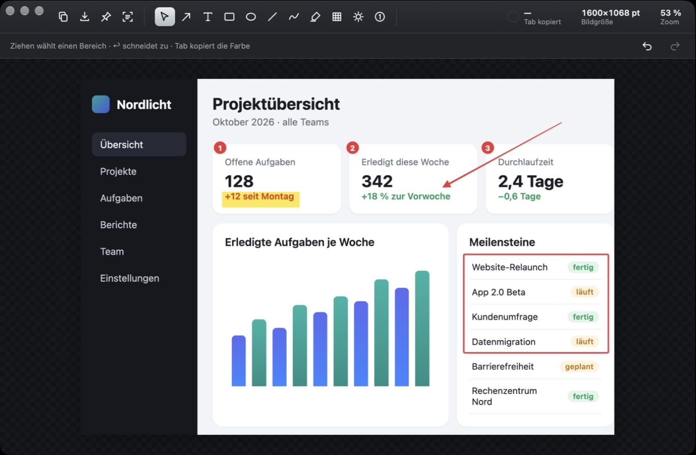
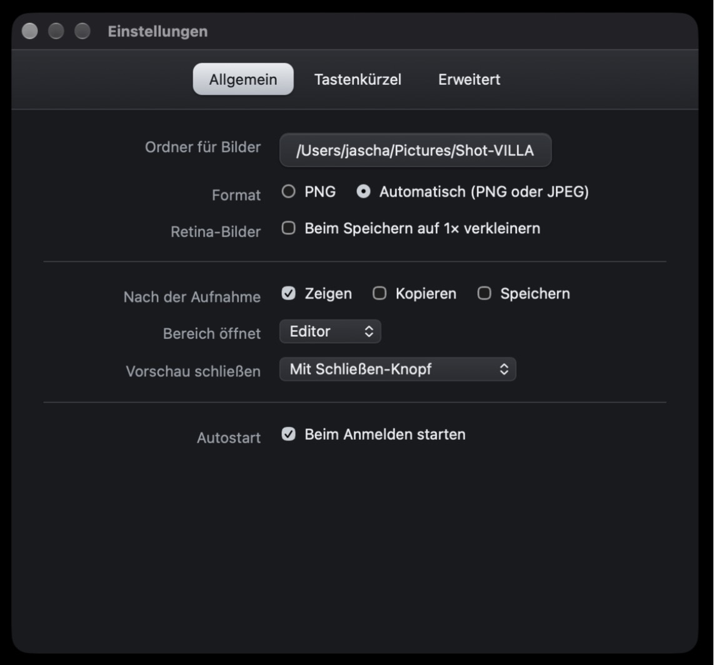
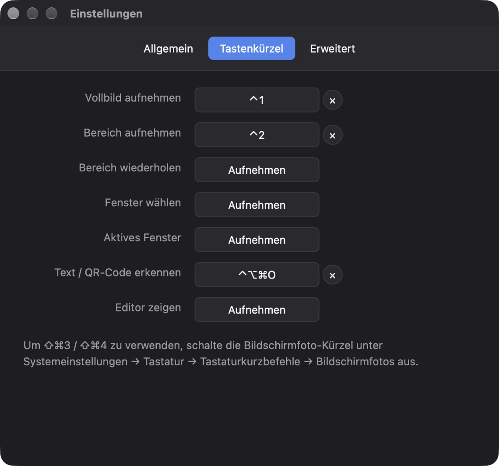
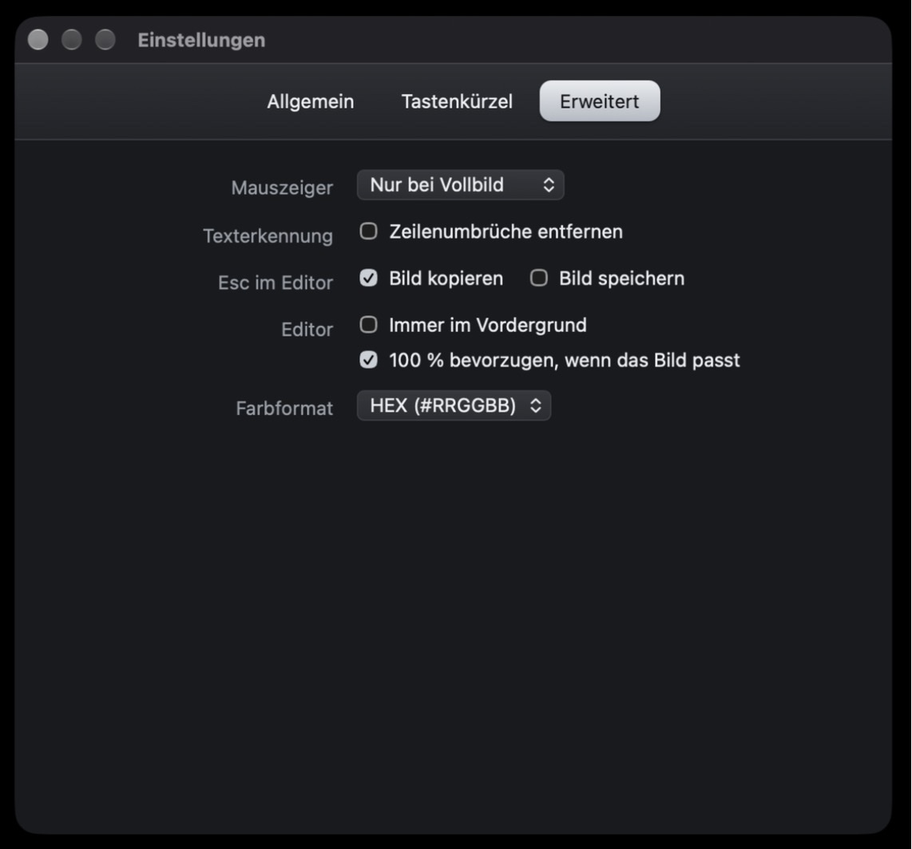

# Shot-VILLA – Handbuch

Shot-VILLA nimmt Bildschirmfotos auf, markiert sie und gibt sie weiter – schnell per Tastenkürzel, ohne Umwege über Ordner. Die App lebt in der Menüleiste; ein Fenster erscheint erst, wenn du eine Aufnahme bearbeitest.



## Inhalt

1. [Installation](#installation)
2. [Erster Start: Bildschirmaufnahme erlauben](#erster-start-bildschirmaufnahme-erlauben)
3. [Aufnehmen](#aufnehmen)
4. [Bearbeiten im Editor](#bearbeiten-im-editor)
5. [Ausgeben: Kopieren, Sichern, Anpinnen](#ausgeben-kopieren-sichern-anpinnen)
6. [Text und QR-Codes erkennen](#text-und-qr-codes-erkennen)
7. [Bildschirmaufnahme (Video)](#bildschirmaufnahme-video)
8. [Einstellungen](#einstellungen)
9. [Tastenkürzel im Überblick](#tastenkürzel-im-überblick)
10. [Fragen und Probleme](#fragen-und-probleme)

## Installation

1. `Shot-VILLA.dmg` laden und öffnen.
2. **Shot-VILLA** in den Ordner **Programme** ziehen.
3. Shot-VILLA aus „Programme“ starten.

Shot-VILLA ist nicht bei Apple notarisiert. macOS meldet deshalb beim Öffnen der DMG und beim ersten Start der App „… nicht geöffnet“. Jeweils so freigeben:

1. In der Meldung auf **Fertig** klicken.
2. *Systemeinstellungen → Datenschutz & Sicherheit* öffnen und ganz nach unten scrollen.
3. Bei „Shot-VILLA.dmg“ bzw. „Shot-VILLA“ auf **„Dennoch öffnen“** klicken und mit dem Passwort bestätigen.

Alternativ im Terminal die Download-Sperre der DMG aufheben, dann entfällt beides:

```bash
xattr -d com.apple.quarantine ~/Downloads/Shot-VILLA.dmg
```

Danach erscheint in der Menüleiste das Shot-VILLA-Symbol (vier Ecken mit einem Punkt). Ein Dock-Symbol gibt es nur, solange ein Shot-VILLA-Fenster offen ist.

Voraussetzung: macOS 14 (Sonoma) oder neuer, Apple-Chip oder Intel.

### Windows

1. `Shot-VILLA-Setup.exe` laden und ausführen. Zeigt Windows „Der Computer wurde durch Windows geschützt“, auf **Weitere Informationen → Trotzdem ausführen** klicken – der Installer ist nicht mit einem gekauften Zertifikat signiert.
2. Shot-VILLA startet und erscheint im **Infobereich der Taskleiste** (ggf. hinter dem Pfeil ˄).

Unter Windows gilt dieses Handbuch mit drei Unterschieden: Kürzel nutzen **Strg** statt ⌘ (z. B. Strg+Umschalt+2 für einen Bereich, Strg+Z zum Widerrufen), eine Freigabe für die Bildschirmaufnahme ist nicht nötig, und die Texterkennung verwendet die in Windows installierten Sprachen. Fenster werden ohne Schatten aufgenommen. Voraussetzung: Windows 10 oder 11.

## Erster Start: Bildschirmaufnahme erlauben

macOS lässt Apps den Bildschirm nur aufnehmen, wenn du es erlaubst.

1. Drück **⇧⌘1**. macOS fragt nach der Berechtigung, und Shot-VILLA zeigt ein Hinweisfenster.
2. Klick auf **Systemeinstellungen öffnen** und schalte **Shot-VILLA** unter *Datenschutz & Sicherheit → Bildschirm- & Systemaudioaufnahme* ein.
3. Klick im Shot-VILLA-Fenster auf **Neu starten**.

Ab jetzt funktionieren alle Aufnahmen. Ohne diese Berechtigung würden Bilder nur den Schreibtischhintergrund zeigen – Shot-VILLA nimmt in diesem Fall gar nicht erst auf, sondern zeigt wieder den Hinweis.

## Aufnehmen

Alle Aufnahmen gibt es im Menüleisten-Symbol und als Tastenkürzel:

| Aufnahme | Vorgabe | So geht's |
|---|---|---|
| **Vollbild** | ⇧⌘1 | Nimmt den Bildschirm auf, auf dem der Mauszeiger steht. |
| **Bereich** | ⇧⌘2 | Der Bildschirm wird eingefroren. Zieh einen Rahmen auf; Lupe und Größenanzeige helfen beim pixelgenauen Ansetzen. **Esc** bricht ab. |
| **Bereich wiederholen** | – | Nimmt denselben Bereich noch einmal auf, z. B. für Vorher/Nachher. |
| **Fenster wählen** | – | Fahr mit der Maus über ein Fenster – es wird hervorgehoben – und klick es an. Fenster werden samt Schatten mit transparentem Hintergrund aufgenommen. |
| **Aktives Fenster** | – | Nimmt sofort das vorderste Fenster der aktiven App auf. |
| **Text / QR-Code erkennen** | ⌃⌥⌘O | Bereich wählen – der erkannte Text landet direkt in der Zwischenablage. |
| **Bild aus Zwischenablage** | ⇧⌘V | Öffnet ein kopiertes Bild im Editor. |
| **Bild öffnen** | ⌘O | Öffnet PNG, JPEG, GIF, HEIC, TIFF oder WebP. Bilder lassen sich auch einfach ins Editorfenster ziehen. |

Kürzel ohne Vorgabe kannst du in den Einstellungen belegen.

**Was passiert danach?** Das stellst du unter *Einstellungen → Allgemein → Nach der Aufnahme* ein: Editor zeigen, sofort kopieren, sofort speichern – oder eine Kombination. Bereichsaufnahmen können statt im Editor auch in einer kleinen **Vorschau** unten rechts erscheinen; von dort kopierst, speicherst oder bearbeitest du mit einem Klick.

## Bearbeiten im Editor

Oben links stehen die Ausgabe-Knöpfe, daneben die Werkzeuge, rechts drei Infos: die Farbe unter dem Mauszeiger, die Bildgröße und der Zoom.

| Werkzeug | Taste | Hinweis |
|---|---|---|
| Auswahl | V | Markierungen anklicken, verschieben, an den Griffen ziehen. Auf leerer Fläche ziehen wählt einen Bereich (für Zuschnitt oder Texterkennung). |
| Pfeil | A | Gefüllte oder offene Spitze; mit ⇧ in 45°-Schritten. |
| Text | T | Klicken und lostippen; **Esc** oder **⌘↩** beendet die Eingabe. Doppelklick bearbeitet vorhandenen Text. Stil „Text“ (mit Kontur) oder „Etikett“ (auf farbigem Grund). |
| Rechteck | R | Rahmen oder gefüllt; mit ⇧ quadratisch. |
| Oval | O | Rahmen oder gefüllt; mit ⇧ kreisrund. |
| Linie | L | Durchgezogen oder gestrichelt. |
| Freihand | D | Freies Zeichnen, automatisch geglättet. |
| Textmarker | H | Legt Farbe hinter den Inhalt, Text bleibt lesbar. |
| Unkenntlich machen | B | Verpixeln oder Weichzeichnen, z. B. für Namen und Passwörter. |
| Spotlight | S | Dunkelt alles außer dem gewählten Bereich ab. |
| Zähler | C | Nummerierte Punkte 1, 2, 3 … – zählt automatisch weiter. |

Unter der Werkzeugleiste wählst du Farbe (acht Vorgaben plus freie Farbe), Stärke (S/M/L/XL) und den Stil des Werkzeugs. Ist eine Markierung ausgewählt, ändern diese Knöpfe genau diese Markierung.

**Weitere Handgriffe**

- **Zuschneiden:** Mit dem Auswahlwerkzeug einen Bereich ziehen und **↩** drücken. *Bearbeiten → Zuschnitt zurücksetzen* holt das ganze Bild zurück.
- **Widerrufen / Wiederholen:** ⌘Z / ⇧⌘Z
- **Verschieben:** Pfeiltasten (mit ⇧ in großen Schritten), **⌘D** dupliziert, **⌫** löscht.
- **Zoom:** ⌘+ / ⌘− / ⌘0 (100 %) / ⌘1 (einpassen), Pinch auf dem Trackpad oder ⌘ + Scrollrad. Ein Klick auf die Zoomanzeige wechselt zwischen 100 % und Einpassen.
- **Pixel oder Punkte:** Ein Klick auf die Größenanzeige wechselt zwischen pt (wie auf dem Bildschirm) und px (echte Bildpunkte auf Retina-Displays).
- **Farbe aufnehmen:** Die Farbe unter dem Mauszeiger steht oben rechts. **Tab** kopiert sie, ein Klick wechselt das Format (HEX, RGB, CSS `rgba()`, OKLCH).

## Ausgeben: Kopieren, Sichern, Anpinnen

| Aktion | Kürzel | Ergebnis |
|---|---|---|
| Bild kopieren | ⇧⌘C (oder **Esc**) | Das bearbeitete Bild liegt in der Zwischenablage, der Editor schließt sich – einfach in der Ziel-App mit ⌘V einfügen. |
| Sichern | ⌘S | Speichert im eingestellten Ordner (Vorgabe: Schreibtisch) als „Shot-VILLA JJJJ-MM-TT um HH.MM.SS“. |
| Sichern unter … | ⇧⌘S | Ort und Format (PNG/JPEG) frei wählen. |
| Anpinnen | ⌘P | Das Bild schwebt rahmenlos über allen Fenstern – praktisch zum Abtippen oder Vergleichen. Verschieben per Ziehen, **Rechtsklick** für 50/100/200 %, halbtransparent, Kopieren und Schließen, **Doppelklick** oder **Esc** schließt. |

**Esc** schließt den Editor. Ist unter *Erweitert → Esc im Editor* „Bild kopieren“ (Vorgabe) bzw. „Bild speichern“ aktiv, passiert das vorher automatisch – ein Bildschirmfoto ist so mit Kürzel, Rahmen, Esc und ⌘V in Sekunden weitergegeben.

Gespeicherte Bilder sind als Bildschirmfoto markiert, Finder und Spotlight erkennen sie entsprechend.

## Text und QR-Codes erkennen

- **Direkt vom Bildschirm:** ⌃⌥⌘O drücken und einen Bereich wählen.
- **Im Editor:** Bereich mit dem Auswahlwerkzeug wählen (oder nichts wählen für das ganze Bild) und **⇧⌘T** drücken.

Der Text wird in Lesereihenfolge in die Zwischenablage gelegt; eine Mitteilung zeigt den Anfang. Enthält der Bereich einen QR- oder Barcode, wird dessen Inhalt kopiert. Die Erkennung läuft vollständig auf deinem Mac (Apple Vision), es verlässt nichts den Rechner. Unter *Erweitert → Texterkennung* lassen sich Zeilenumbrüche entfernen – getrennte Wörter am Zeilenende werden dabei wieder zusammengefügt.

## Bildschirmaufnahme (Video)

Nimmt einen Bereich des Bildschirms als Video auf (macOS 15 oder neuer).

1. **⌃⌥⌘R** drücken oder im Menüleisten-Symbol **Bildschirmaufnahme (Bereich) …** wählen.
2. Den Bereich aufziehen – wie beim Bereichsfoto. Ein gestrichelter Rahmen markiert ihn, mittig darunter erscheint eine Leiste mit **Start**. Noch wird nichts aufgenommen.
3. Auf **Start** klicken (oder erneut **⌃⌥⌘R**). Jetzt läuft die Aufnahme: Der Rahmen wird rot, die Leiste zeigt die Laufzeit, ebenso die Menüleiste neben dem Symbol. **×** oder **Esc** verwirft den Bereich vorher wieder.
4. Zum Beenden auf **Stopp** klicken, erneut **⌃⌥⌘R** drücken oder im Menü **Bildschirmaufnahme beenden** wählen.

Das Video landet als MP4 (H.264, Retina-Auflösung, 30 Bilder pro Sekunde, mit Mauszeiger, ohne Ton) im eingestellten Ordner, z. B. „Shot-VILLA 2026-10-16 um 17.19.46.mp4“; der Finder zeigt es danach an. Rahmen und Leiste erscheinen nicht im Video. Unter Windows gibt es die Videoaufnahme noch nicht.

## Einstellungen

Erreichbar über das Menüleisten-Symbol → *Einstellungen …* oder **⌘,**.

### Allgemein



- **Ordner für Bilder:** Ziel für ⌘S und automatisches Speichern.
- **Format:** PNG oder automatisch – Fotos und Verläufe werden als JPEG gespeichert, Oberflächen und Text als PNG.
- **Retina-Bilder:** Beim Speichern auf 1× verkleinern, damit Bilder so groß bleiben, wie sie auf dem Bildschirm aussahen.
- **Nach der Aufnahme**, **Bereich öffnet** (Editor oder Vorschau), **Vorschau schließen** (Knopf oder Klick daneben), **Autostart**.

### Tastenkürzel



Klick in ein Feld und drück die gewünschte Kombination; **×** entfernt ein Kürzel, **Esc** bricht ab. Während der Eingabe sind alle Shot-VILLA-Kürzel pausiert. Ist eine Kombination schon vergeben, meldet Shot-VILLA das unter den Feldern.

Willst du **⇧⌘3 / ⇧⌘4** nutzen, schalte zuerst die Bildschirmfoto-Kürzel von macOS aus: *Systemeinstellungen → Tastatur → Tastaturkurzbefehle → Bildschirmfotos*.

### Erweitert



- **Mauszeiger:** nur bei Vollbild, immer oder nie mit aufnehmen.
- **Texterkennung:** Zeilenumbrüche entfernen.
- **Esc im Editor:** Bild kopieren und/oder speichern.
- **Editor:** immer im Vordergrund; 100 % bevorzugen, wenn das Bild ins Fenster passt.
- **Farbformat** für die Pipette.

Die Einstellungen liegen in `~/Library/Application Support/de.villalife.shot-villa/settings.json`.

## Tastenkürzel im Überblick

**Global** (überall, frei belegbar): ⇧⌘1 Vollbild · ⇧⌘2 Bereich · ⌃⌥⌘O Text erkennen · ⌃⌥⌘R Bildschirmaufnahme starten/beenden · weitere in den Einstellungen.

**Im Editor**

| | |
|---|---|
| V A T R O L D H B S C | Werkzeuge |
| ⇧⌘C · Esc | Kopieren (Esc schließt danach) |
| ⌘S · ⇧⌘S | Sichern · Sichern unter |
| ⌘P | Anpinnen |
| ⇧⌘T | Text erkennen |
| ⌘Z · ⇧⌘Z | Widerrufen · Wiederholen |
| ↩ | Auf Auswahl zuschneiden |
| ⌘D · ⌫ | Duplizieren · Löschen |
| Pfeiltasten (⇧) | Verschieben (in großen Schritten) |
| ⌘+ ⌘− ⌘0 ⌘1 | Zoom: größer, kleiner, 100 %, einpassen |
| Tab | Farbe unter dem Mauszeiger kopieren |
| ⌘O · ⇧⌘V | Bild öffnen · aus Zwischenablage |

## Fragen und Probleme

**Es erscheint immer wieder der Hinweis zur Bildschirmaufnahme.**
Entferne Shot-VILLA unter *Datenschutz & Sicherheit → Bildschirm- & Systemaudioaufnahme* mit „−“, erlaube es neu und starte Shot-VILLA neu. Im Terminal geht das Zurücksetzen mit `tccutil reset ScreenCapture de.villalife.shot-villa`.

**Ein Kürzel reagiert nicht.**
Eine andere App nutzt dieselbe Kombination. Shot-VILLA zeigt das in den Einstellungen unter den Kürzeln an – wähl eine andere Kombination oder schalte das Kürzel in der anderen App ab.

**Das Menüleisten-Symbol fehlt.**
Bei vielen Symbolen blendet macOS manche hinter der Kamera-Aussparung aus. Die Aufnahmen funktionieren trotzdem per Kürzel; die Einstellungen öffnest du dann mit **⌘,**, sobald ein Shot-VILLA-Fenster vorne ist.

**Wird etwas ins Internet geschickt?**
Nein. Aufnahmen, Texterkennung und Einstellungen bleiben auf deinem Mac.
